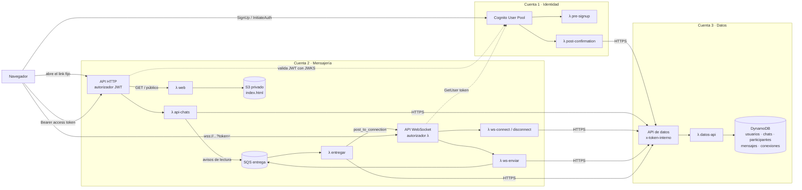

# Plataforma de mensajería en 3 cuentas de AWS Academy (Terraform)

Chat en tiempo real (1 a 1 y grupos) repartido en **tres cuentas de AWS Academy Learner Lab**,
desplegado con **Terraform**, con **autenticación en Amazon Cognito** y toda la información guardada en
**DynamoDB en una cuenta dedicada a datos**.

| Cuenta | Rol | Servicios |
|---|---|---|
| **1. Identidad** | Registro e inicio de sesión | Cognito User Pool + App Client, Lambdas *Pre Sign-up* y *Post Confirmation* |
| **2. Mensajería** | Lógica de la plataforma | API Gateway HTTP (REST), API Gateway WebSocket, 7 Lambdas, SQS (+ DLQ), S3 (frontend privado, servido por la API HTTP) |
| **3. Datos** | Persistencia | 5 tablas DynamoDB, Lambda + API HTTP interna de datos |

---

## 1. Arquitectura



### Cómo se conectan las cuentas (y por qué así)

En Learner Lab **no se pueden crear roles IAM** (solo existe `LabRole`) y **no hay assume-role entre
cuentas**, así que la conexión entre cuentas es por **HTTPS**, no por IAM:

1. **Cuenta 2 → Cuenta 1 (autenticación).** Cognito firma los tokens JWT con llaves públicas (JWKS).
   - La **API HTTP** usa un *autorizador JWT* nativo con el `issuer` del User Pool de la cuenta 1 y el
     `client_id` como audiencia. API Gateway descarga las llaves públicas y valida la firma sin permisos.
   - La **API WebSocket** recibe el token en `?token=` (el navegador no puede mandar headers al abrir
     un WebSocket). Un autorizador Lambda revisa `iss`, `client_id`, `token_use` y `exp`, y luego llama
     a `cognito-idp:GetUser`, que se autentica solo con el token, por lo que funciona desde otra cuenta.
2. **Cuentas 1 y 2 → Cuenta 3 (datos).** La cuenta 3 es la única que toca DynamoDB. Expone una
   *API de datos* interna; las otras cuentas la llaman con el header `x-token-interno`, un secreto
   de 48 caracteres que Terraform genera (`random_password`) y pasa como variable de entorno a las Lambdas.

> En una cuenta AWS normal lo ideal sería reemplazar el token interno por un rol IAM cross-account
> (`sts:AssumeRole`) o por una política de recurso en DynamoDB, y firmar las llamadas con SigV4.
> Vale la pena mencionarlo en la presentación como "mejora fuera del laboratorio".

### Flujo: enviar un mensaje

1. Alice inicia sesión en Cognito (cuenta 1) y recibe un **access token**.
2. Abre el WebSocket de la cuenta 2 con `?token=...`. El autorizador valida el token y `ws-connect`
   guarda la conexión en la tabla `conexiones` (cuenta 3).
3. Alice manda `{"action":"enviarMensaje","chatId":"...","texto":"Hola"}`.
4. `ws-enviar` verifica que Alice está en el chat, **guarda el mensaje** en `mensajes` (cuenta 3) y lo
   encola en **SQS**.
5. `entregar` lee la cola, busca los participantes y sus conexiones abiertas, y les empuja el mensaje
   con `post_to_connection`. Si una conexión murió (`GoneException`) la borra.
6. Si Bob estaba offline, verá el mensaje al abrir el chat (`GET /chats/{chatId}/mensajes`).

SQS desacopla "guardar" de "repartir": si la entrega falla se reintenta hasta 3 veces y luego va a la DLQ,
pero el mensaje ya quedó guardado.

### Flujo: confirmación de lectura ("visto")

1. Bob abre el chat (con la pestaña visible). El cliente llama `POST /chats/{chatId}/leido` con
   `{"hasta": <enviadoEn del último mensaje>}`.
2. `api-chats` guarda `leidoHasta` en la fila de Bob de la tabla `participantes` (cuenta 3). La
   actualización es condicional: solo avanza, nunca retrocede, y falla si Bob no es participante.
3. Si cambió, `api-chats` encola `{"tipo":"leido","chatId","userId","leidoHasta"}` en la **misma cola
   SQS**, y `entregar` lo reparte por WebSocket a los participantes.
4. El cliente de Alice marca sus mensajes con `enviadoEn <= leidoHasta` como leídos: ✓ = enviado,
   ✓✓ gris = entregado a todos, ✓✓ azul = leído por todos, y "Visto" / "Visto por …" bajo su último mensaje.

### Flujo: entregado (✓✓ gris)

1. Cuando `entregar` logra empujar un mensaje nuevo a al menos una conexión de Bob, guarda
   `entregadoHasta` en su fila de `participantes` (misma escritura condicional: solo avanza).
2. Si cambió, le manda a Alice `{"tipo":"entregado","chatId","userId","entregadoHasta"}` por WebSocket.
3. Si Bob estaba desconectado, se marca cuando descarga el historial (`GET /chats/{chatId}/mensajes`).
4. Es secundario: si falla solo queda un `WARN` y el mensaje no se reintenta (evita duplicados).

### Nombre de los chats

- **1 a 1 sin nombre:** cada participante ve el nombre de la otra persona (Ana ve "Bob" y Bob ve
  "Ana"). Funciona porque el nombre se guarda por participante (`nombreChat` en `participantes`).
- **Un solo chat 1 a 1 sin nombre por pareja:** su `chatId` es un UUIDv5 derivado de los dos `userId`
  ordenados y se crea con escritura condicional (`attribute_not_exists`). Si Ana o Bob intentan crear
  otro, la API responde 200 con `"existente": true` y el cliente abre el chat que ya existía. Los chats
  1 a 1 **con** nombre sí pueden repetirse.
- **Grupos (3+ personas):** el nombre es obligatorio; la API responde 400 si falta.

### Agregar personas a un chat

Cualquier participante puede agregar personas con `POST /chats/{chatId}/miembros` (botón 👤+ en la
cabecera del chat). Solo vale para chats **con nombre**: el 1 a 1 sin nombre no admite más miembros
(se responde 400; hay que crear un grupo). Si un 1 a 1 con nombre recibe a alguien, pasa a ser grupo.
Los nuevos miembros ven el historial, y todos reciben `{"tipo":"miembrosAgregados"}` por WebSocket.

### Borrar mensajes

El autor de un mensaje puede borrarlo para todos (icono de papelera al pasar el ratón sobre su burbuja).
Es un borrado lógico: el mensaje queda con `borrado: true` y sin `texto`, así se conserva el orden y los
"visto". La condición de DynamoDB `remitenteId = :yo` impide borrar mensajes ajenos (403). Los demás
reciben `{"tipo":"mensajeBorrado"}` y ven "🚫 Mensaje eliminado".

### Eliminar un chat

Menú ⋮ en la cabecera del chat, `DELETE /chats/{chatId}?para=mi|todos`:

| | 1 a 1 | Grupo |
|---|---|---|
| **Para mí** (`para=mi`) | Se oculta de mi lista y se borra **mi** historial (`oculto` + `borradoHasta` en mi fila de `participantes`). Si la otra persona vuelve a escribir, reaparece solo con los mensajes nuevos | Salgo del grupo (se borra mi fila). Si era el último miembro, se borra todo |
| **Para todos** (`para=todos`) | Cualquiera de los dos | Solo quien creó el grupo (403 si no) |

"Para todos" borra las filas de `participantes`, todos los `mensajes` (paginando) y el chat. Como los
participantes ya no existen, el aviso de SQS lleva la lista `para` con a quién entregarlo
(`chatEliminado`, `chatOculto`, `miembroSalio`).

### Modelo de datos (cuenta 3)

| Tabla | Clave | Índice | Para qué |
|---|---|---|---|
| `usuarios` | `userId` (= `sub` de Cognito) | `por_email` | Perfil; buscar a quién agregar a un chat |
| `chats` | `chatId` | | Nombre y creador del chat |
| `participantes` | `chatId` + `userId` | `por_usuario` (`userId`, `chatId`) | Miembros de un chat / chats de un usuario. Guarda `nombreChat` (cómo ve el chat ese usuario), `esGrupo`, `directo` (1 a 1 sin nombre), `creadorId`, `leidoHasta`, y `oculto`/`borradoHasta` si lo eliminé para mí (último mensaje leído, en ms) |
| `mensajes` | `chatId` + `sk` (`timestamp#messageId`) | | Historial ordenado por tiempo. Los borrados llevan `borrado: true` y no tienen `texto` |
| `conexiones` | `connectionId` | `por_usuario` | WebSockets abiertos, con TTL de 24 h |

### APIs

**API HTTP (cuenta 2)**, header `Authorization: <access token>` (salvo `GET /`):

| Método | Ruta | Descripción |
|---|---|---|
| GET | `/` | **Pública.** Devuelve el frontend (lo lee del bucket S3 privado) |
| GET | `/yo` | Mi perfil |
| PUT | `/yo` | Crea/actualiza mi perfil (respaldo del trigger) |
| GET | `/chats` | Mis chats (`chatId`, `nombre`, `esGrupo`, `directo`, `leidoHasta`) |
| POST | `/chats` | `{"nombre":"Grupo","emails":["bob@x.com"]}`. `nombre` es opcional en 1 a 1 y obligatorio en grupos. Un 1 a 1 sin nombre que ya existe devuelve 200 con `"existente": true` |
| GET | `/chats/{chatId}/mensajes` | Últimos 50 mensajes (solo participantes) |
| GET | `/chats/{chatId}/miembros` | Participantes con `nombre`, `email` y `leidoHasta` (solo participantes) |
| POST | `/chats/{chatId}/miembros` | `{"emails":["carla@x.com"]}`: agrega personas (solo chats con nombre, solo participantes) |
| POST | `/chats/{chatId}/leido` | `{"hasta": <ms>}`: marca el chat como leído y avisa a los demás |
| DELETE | `/chats/{chatId}/mensajes/{messageId}?enviadoEn=<ms>` | Borra para todos un mensaje propio |
| DELETE | `/chats/{chatId}?para=mi\|todos` | Elimina el chat para mí / salgo del grupo, o lo elimina para todos |

**API WebSocket (cuenta 2)**: `wss://.../prod?token=<access token>`

- Cliente → servidor: `{"action":"enviarMensaje","chatId":"...","texto":"..."}`
- Servidor → cliente:
  - `{"tipo":"nuevoMensaje","mensaje":{...}}`
  - `{"tipo":"leido","chatId":"...","userId":"...","leidoHasta":1795...}`
  - `{"tipo":"miembrosAgregados","chatId":"...","agregados":["<userId>"],"por":"<userId>"}`
  - `{"tipo":"mensajeBorrado","chatId":"...","messageId":"..."}`
  - `{"tipo":"chatEliminado" | "chatOculto" | "miembroSalio","chatId":"...","userId":"<quién>"}`
  - `{"tipo":"error","error":"..."}`

### Cliente web (`frontend/index.html`)

Un solo archivo HTML sin dependencias: pantalla de acceso con pestañas (iniciar sesión / crear cuenta),
lista de chats con avatar, vista previa y contador de no leídos, burbujas agrupadas por autor con hora
y separadores por día, ✓/✓✓ de lectura, nombres de los participantes, ventana "Nuevo chat" con correos
como etiquetas, reconexión automática del WebSocket, modo oscuro y diseño para móvil.

---

## 2. Estructura del proyecto

```
mensajeria-aws/
├── terraform/
│   ├── versions.tf          # Terraform >= 1.5, providers aws/archive/random
│   ├── providers.tf         # 3 providers con alias: identidad, mensajeria, datos
│   ├── variables.tf
│   ├── main.tf              # token interno + los 3 módulos
│   ├── frontend.tf          # bucket S3 privado + subida de index.html con la config incrustada
│   ├── outputs.tf           # incluye frontend_url (link fijo)
│   ├── terraform.tfvars.example
│   └── modules/
│       ├── identidad/       # Cuenta 1: Cognito + triggers
│       ├── mensajeria/      # Cuenta 2: APIs, Lambdas, SQS
│       ├── datos/           # Cuenta 3: DynamoDB + API de datos
│       └── observabilidad/  # (x3) SNS de alertas + λ Telegram + métricas y consultas de logs
├── lambdas/                 # Python 3.12, solo boto3 (sin dependencias extra)
│   ├── identidad/           # pre_signup, post_confirmation
│   ├── mensajeria/          # ws_authorizer, ws_connect, ws_disconnect, ws_enviar, entregar, api_chats, web
│   ├── datos/               # datos_api
│   └── alertas/             # telegram (suscriptor SNS → Bot API de Telegram)
│   # registro.py (logs JSON) y metricas.py están copiados en cada carpeta
├── frontend/index.html      # Cliente web
└── scripts/
    ├── configurar_perfiles.sh   # crea un perfil de AWS CLI por cuenta
    ├── generar_config.sh        # config.js para desarrollo local
    ├── generar_url.sh           # URL pre-firmada del bucket (alternativa al link fijo)
    ├── telegram_chat_id.sh      # obtiene el chat_id para las alertas
    ├── probar_alertas.sh        # fuerza una alarma para probar SNS → Telegram
    └── sqs_dlq.sh               # demo en vivo de la cola SQS y la DLQ
```

Todas las Lambdas usan el rol existente **`LabRole`** (`data "aws_iam_role"`); Terraform no crea
ningún rol ni política IAM.

---

## 3. Despliegue paso a paso

### Requisitos
- Terraform >= 1.5 y AWS CLI v2.
- Tres cuentas de AWS Academy Learner Lab con el lab **iniciado** (círculo verde).

### Paso 1. Iniciar los tres labs
En cada curso de Learner Lab: **Start Lab** → espera el círculo verde → **AWS Details** → **AWS CLI: Show**.

### Paso 2. Crear un perfil por cuenta
Las credenciales de Learner Lab son temporales (traen `aws_session_token` y caducan a las ~4 horas),
así que este paso se repite cada vez que reinicias el lab.

> Si aparece `permission denied`, dale permiso de ejecución una vez: `chmod +x scripts/*.sh`
> (o ejecútalo con `bash scripts/configurar_perfiles.sh ...`).

```bash
./scripts/configurar_perfiles.sh cuenta-identidad    # pega el bloque de la cuenta 1
./scripts/configurar_perfiles.sh cuenta-mensajeria   # pega el bloque de la cuenta 2
./scripts/configurar_perfiles.sh cuenta-datos        # pega el bloque de la cuenta 3
```

O a mano en `~/.aws/credentials`:

```ini
[cuenta-identidad]
aws_access_key_id=ASIA...
aws_secret_access_key=...
aws_session_token=...

[cuenta-mensajeria]
...

[cuenta-datos]
...
```

Comprueba que son 3 cuentas distintas:

```bash
for p in cuenta-identidad cuenta-mensajeria cuenta-datos; do aws sts get-caller-identity --profile $p --query Account --output text; done
```

### Paso 3. Desplegar

```bash
cd terraform
cp terraform.tfvars.example terraform.tfvars   # opcional, los valores por defecto ya sirven
terraform init
terraform plan
terraform apply
```

Un solo `apply` despliega las tres cuentas. Terraform resuelve el orden solo: primero la cuenta 3
(datos), luego la 1 (Cognito necesita la URL de datos) y luego la 2 (necesita Cognito y datos).
Si los perfiles apuntan a la misma cuenta, el bloque `check` avisa.

### Paso 4. Abrir el cliente web (link fijo)

`terraform apply` sube `frontend/index.html` a un **bucket S3 privado de la cuenta 2**, con la
configuración (Cognito y URLs de las APIs) ya incrustada, y la API HTTP lo sirve en la ruta pública `GET /`:

```bash
terraform output -raw frontend_url    # https://<id>.execute-api.us-east-1.amazonaws.com/
```

- Cualquiera puede abrirlo y **no caduca** (no depende de las credenciales del lab).
- Cambia solo si haces `terraform destroy` y vuelves a desplegar (la API nueva tiene otra URL).
- Para compartirlo más corto puedes pasarlo por un acortador (bit.ly, TinyURL).
- Alternativa: `./scripts/generar_url.sh` genera una URL pre-firmada del bucket (deja de servir cuando
  caduca la sesión del lab, ~4 h).

Ábrelo en **dos navegadores** (o uno normal y uno en incógnito):

1. Registra a `alice@test.com` y a `bob@test.com` (contraseña de 8+ caracteres con minúscula y número).
2. Inicia sesión con cada uno.
3. Alice pulsa **Nuevo**, escribe `bob@test.com` y crea el chat sin nombre: Alice lo ve como "bob" y Bob como "alice".
4. Al chat de Bob le aparece solo; ambos se escriben en tiempo real.
5. Cuando Bob abre el chat, los mensajes de Alice pasan de ✓ a ✓✓ azul y aparece "Visto".
6. Para un grupo, añade 2+ correos: el nombre es obligatorio.

Para desarrollo local sigue funcionando `./scripts/generar_config.sh` + `python3 -m http.server`.

### Paso 5 (opcional). Probar con la terminal

```bash
cd terraform
CLIENT=$(terraform output -raw cognito_client_id)
API=$(terraform output -raw api_http_url)
WS=$(terraform output -raw api_websocket_url)

aws cognito-idp sign-up --client-id $CLIENT --username alice@test.com --password 'clave1234' \
  --user-attributes Name=email,Value=alice@test.com --profile cuenta-identidad
TOKEN=$(aws cognito-idp initiate-auth --client-id $CLIENT --auth-flow USER_PASSWORD_AUTH \
  --auth-parameters USERNAME=alice@test.com,PASSWORD='clave1234' \
  --query AuthenticationResult.AccessToken --output text --profile cuenta-identidad)

curl -H "Authorization: $TOKEN" $API/yo
curl -H "Authorization: $TOKEN" -H 'content-type: application/json' \
  -d '{"emails":["bob@test.com"]}' $API/chats            # 1 a 1 sin nombre
curl -H "Authorization: $TOKEN" $API/chats/<chatId>/miembros
npx wscat -c "$WS?token=$TOKEN"
> {"action":"enviarMensaje","chatId":"<id>","texto":"hola"}
```

### Evidencias para la entrega
- `terraform output cuentas` muestra los 3 IDs de cuenta.
- Consola de la cuenta 1: Cognito → User pools → usuarios registrados.
- Consola de la cuenta 3: DynamoDB → `mensajeria-mensajes` → *Explore items*.
- CloudWatch Logs de cada cuenta (`/aws/lambda/mensajeria-*`).

### Paso 6. Destruir

```bash
cd terraform && terraform destroy
```

Hazlo antes de que caduquen las credenciales; si caducan, repite el paso 2 y vuelve a ejecutar.

---

## 4. Observabilidad y monitoreo

Hay tres formas de ver qué está pasando, de la más rápida a la más detallada:

### 4.1 Panel "Monitoreo" dentro de la app
Botón 📈 en la barra lateral. Muestra la **última hora en intervalos de 5 min** de las **tres cuentas**
en una sola pantalla, con sus alarmas, y se actualiza cada minuto.

```
Navegador ─GET /monitoreo (JWT)─► λ monitoreo (cuenta 2) ─┬─► CloudWatch cuenta 2
                                                          ├─► GET /monitoreo cuenta 1 ─► CloudWatch cuenta 1
                                                          └─► GET /monitoreo cuenta 3 ─► CloudWatch cuenta 3
```

Cada cuenta solo puede leer su propio CloudWatch (no hay roles entre cuentas en Learner Lab), así
que las cuentas 1 y 3 exponen sus métricas por HTTPS con el mismo `x-token-interno` y la cuenta 2 las
junta en paralelo. Si una cuenta falla, el panel muestra las otras dos.

| Cuenta | Qué muestra |
|---|---|
| 1 · Identidad | Registros, inicios de sesión, renovaciones de token, throttles de Cognito, invocaciones y errores del trigger |
| 2 · Mensajería | Peticiones/latencia p95/5xx de la API HTTP, conexiones y mensajes WebSocket, invocaciones, **instancias Lambda simultáneas**, errores y throttles, duración de `entregar`, mensajes encolados, **en espera** y antigüedad en SQS, mensajes en la DLQ |
| 3 · Datos | Peticiones/latencia/5xx de la API de datos, **instancias simultáneas** y duración de su Lambda, unidades de lectura/escritura de DynamoDB, latencia de escritura, throttles |

### 4.2 Dashboards de CloudWatch (uno por cuenta)
`terraform output dashboards_cloudwatch` da los enlaces (`mensajeria-identidad`, `mensajeria-mensajeria`,
`mensajeria-datos`). Ábrelos con la sesión de consola de **esa** cuenta (AWS Details → AWS Console del lab).
Tienen más detalle que el panel: series por función y por tabla, p50/p95, el estado de las alarmas y
una tabla con los **últimos errores de los logs** (CloudWatch Logs Insights).

### 4.3 Alarmas
Todas empiezan por `mensajeria-` y usan `treat_missing_data = notBreaching` (sin tráfico = OK):

| Cuenta | Alarma | Se dispara si… |
|---|---|---|
| 1 | `identidad-triggers-errores` | falla el trigger post-confirmation |
| 1 | `identidad-cognito-limitado` | Cognito limita inicios de sesión |
| 2 | `mensajeria-dlq-con-mensajes` | hay mensajes en la DLQ |
| 2 | `mensajeria-cola-atrasada` | el mensaje más viejo de la cola lleva > 60 s |
| 2 | `mensajeria-lambda-errores` / `-lambda-limitadas` | alguna Lambda falla / es limitada |
| 2 | `mensajeria-api-http-5xx` / `-websocket-errores` | errores 5xx / de ejecución |
| 3 | `datos-api-5xx` / `datos-lambda-errores` | la API de datos o su Lambda fallan |
| 3 | `datos-api-lenta` | latencia p95 > 1 s durante 10 min |
| 3 | `datos-dynamodb-limitado` | DynamoDB limita lecturas o escrituras (suma de las 5 tablas) |
| 2 | `mensajeria-cuenta-datos-lenta` | las llamadas a la cuenta 3 tardan > 1,5 s (p95, desde logs) |
| 1, 2, 3 | `<cuenta>-errores-aplicacion` | alguna Lambda escribió un log con `nivel = ERROR` o tuvo un timeout |
| 1, 2, 3 | `<cuenta>-telegram-falla` | la Lambda de Telegram no pudo enviar (sin acción, para evitar bucles) |

Todas (salvo `telegram-falla`) publican en el tema SNS `mensajeria-alertas` de su cuenta al pasar a
**ALARM** y al volver a **OK**, y de ahí llegan a Telegram (sección 4.6).

### 4.4 Prueba de carga (para ver el escalado)

```bash
node scripts/prueba_carga.mjs                         # 5 usuarios × 20 mensajes a 10 msg/s
node scripts/prueba_carga.mjs --usuarios 10 --mensajes 50 --ritmo 40
node scripts/prueba_carga.mjs --ritmo 120             # supera el límite de la API WebSocket (throttling)
```

Crea usuarios `cargaN@test.com`, un grupo, un WebSocket por usuario y envía mensajes a ritmo constante.
Al final informa cuántas entregas en tiempo real llegaron y la latencia envío→entrega (p50/p95).
Cada mensaje genera `usuarios` entregas, así que 10 usuarios × 50 mensajes = 5 000 envíos por WebSocket.
En 1-3 minutos el panel muestra subir las invocaciones, las **instancias Lambda simultáneas**, los mensajes
en espera de SQS y las unidades de DynamoDB, mientras la latencia se mantiene estable.

### 4.5 Logs estructurados (CloudWatch Logs)
Cada Lambda escribe **una línea JSON por evento** con `lambdas/*/registro.py` (sin dependencias):

```json
{"nivel": "INFO", "evento": "mensaje_enviado", "funcion": "mensajeria-ws-enviar",
 "request_id": "6c1f…", "correlacion": "6c1f…", "ruta": "enviarMensaje",
 "user_id": "…", "chat_id": "…", "message_id": "…", "longitud": 12}
```

- El decorador `@instrumentado` del handler registra `invocacion_completada` con `duracion_ms` y
  `status` (4xx → `WARN`, 5xx → `ERROR`) y cualquier excepción no controlada con su traza.
- **Correlación entre cuentas:** el `correlacion` nace en la Lambda que recibe la petición y viaja en
  el header `x-correlacion` hacia la API de datos (cuenta 3) y como atributo del mensaje SQS hacia
  `entregar`. Así se sigue un mensaje completo: `ws-enviar` → `datos-api` → SQS → `entregar` → `datos-api`.
- Cada llamada a la cuenta 3 queda como `llamada_datos` con su latencia y código.
- Nunca se registran tokens, cuerpos de mensaje ni correos.
- Retención: 7 días. Nivel mínimo con la variable de entorno `NIVEL_LOG` (por defecto `INFO`).

**Dónde verlos:** CloudWatch → *Logs Insights* (`terraform output logs_insights_url`) → *Consultas
guardadas* → carpeta `mensajeria-<cuenta>/`:

| Consulta | Para qué |
|---|---|
| 1 Errores recientes | líneas `ERROR` y timeouts con función, ruta y correlación |
| 2 Avisos recientes | 4xx, conexiones rechazadas, llamadas fallidas |
| 3 Duración por ruta | invocaciones, promedio, p95 y máximo por función/ruta |
| 4 Códigos de respuesta | conteo por ruta y `status` |
| 5 Seguir una operación | pega un `correlacion` y ves todos sus pasos en orden (en cada cuenta) |
| 6 Arranques en frío y memoria | a partir de las líneas `REPORT` de Lambda |

**Métricas a partir de los logs** (namespace `mensajeria/Aplicacion`, filtros de métricas):
`ErroresAplicacion`, `AvisosAplicacion`, `TimeoutsLambda` (las 3 cuentas), `MensajesEnviados`,
`EntregasWebSocket`, `ConexionesRechazadas`, `LatenciaCuentaDatos` (cuenta 2) y `UsuariosRegistrados`
(cuenta 1). Aparecen en los dashboards.

### 4.6 Alertas por Telegram (SNS)

```
Alarma CloudWatch ─► SNS mensajeria-alertas ─► λ mensajeria-alertas-telegram ─► Bot API de Telegram
   (ALARM / OK)                            └─► correo (opcional, email_alertas)
```

Hay un tema y una Lambda **por cuenta** (sin roles entre cuentas en Learner Lab); las tres usan el
mismo bot y chat. Ejemplo de aviso:

```
🔴 ALARMA · Cuenta 2 · Mensajería
mensajeria-mensajeria-dlq-con-mensajes
Hay entregas que fallaron 3 veces y quedaron en la DLQ.

Estado: OK → ALARM
Motivo: Threshold Crossed: 1 datapoint [2.0] was greater than the threshold (0.0).
🕒 20/11/2026 15:04:05 UTC
Ver en CloudWatch
```

Configuración:
1. En Telegram, habla con **@BotFather** → `/newbot` → copia el token.
2. Escríbele cualquier cosa a tu bot (o agrégalo a un grupo y escribe ahí).
3. `bash scripts/telegram_chat_id.sh <token>` → imprime la línea `telegram_chat_id = "..."`.
4. En `terraform/terraform.tfvars` (no se sube al repo):
   ```hcl
   telegram_bot_token = "123456789:AA..."
   telegram_chat_id   = "987654321"
   ```
5. `terraform -chdir=terraform apply`
6. Prueba: `bash scripts/probar_alertas.sh` → llega una 🔴 ALARMA por cuenta y, ≈5 min después, ✅ RESUELTA.

**Avisos de actividad (chat o grupo nuevo).** Además de las alarmas, cada chat o grupo creado manda
un aviso por un tema aparte, `mensajeria-eventos` (cuenta 2), a la misma Lambda de Telegram:

```
λ api-chats (POST /chats → 201) ─► SNS mensajeria-eventos ─► λ mensajeria-alertas-telegram ─► Telegram

👥 Nuevo grupo · Cuenta 2 · Mensajería
«Equipo DSE»
Creado por: Yana
Participantes: 4
```

- No se avisa cuando el chat 1 a 1 ya existía (respuesta 200).
- Es solo un aviso: si SNS falla, el chat se crea igual y queda un `WARN notificacion_chat_fallida`.
- Va en un tema separado de las alertas para que el correo opcional no reciba un aviso por cada chat.
- Se desactiva con `notificar_chats = false` en `terraform.tfvars`.

Sin token, la Lambda solo deja un `WARN telegram_sin_configurar` en sus logs. Si el token o el chat
están mal, se dispara `<cuenta>-telegram-falla` (visible en el panel y los dashboards).

### 4.7 Ver funcionando SQS + DLQ (`scripts/sqs_dlq.sh`)

```bash
bash scripts/sqs_dlq.sh demo        # 5 mensajes normales + 3 "veneno", y mira cómo llegan a la DLQ (≈4 min)
bash scripts/sqs_dlq.sh vigilar     # estado en vivo de la cola y la DLQ cada 5 s
bash scripts/sqs_dlq.sh logs        # en otra terminal: éxitos y fallos de la Lambda entregar
bash scripts/sqs_dlq.sh ver-dlq     # qué hay en la DLQ y cuántas veces se intentó
bash scripts/sqs_dlq.sh reprocesar  # redrive: devuelve la DLQ a la cola
bash scripts/sqs_dlq.sh vaciar-dlq  # limpia la DLQ (pide confirmación)
```

- **Normal** (`{"tipo":"demoSqs","para":[]}`): `entregar` lo procesa sin destinatarios y SQS lo borra
  en segundos. No toca usuarios ni chats reales.
- **Veneno** (sin `chatId`): `entregar` falla y lo reporta en `batchItemFailures`. Solo ese mensaje
  se reintenta, los demás del lote no. Vuelve a ser visible a los 60 s (visibility timeout) y, tras
  **3 recepciones** (`maxReceiveCount`), SQS lo mueve a `mensajeria-entrega-dlq`, donde se guarda 14 días.
- Al llegar a la DLQ se disparan `mensajeria-dlq-con-mensajes` y `mensajeria-errores-aplicacion`,
  que avisan por Telegram, y el panel 📈 muestra los mensajes en la DLQ.
- Cada mensaje de la demo lleva `correlacion = demo-sqs-<tipo>-<n>`, así que se puede seguir con la
  consulta guardada *5 Seguir una operación* de Logs Insights.

## 5. Consideraciones de Learner Lab

- **Región:** solo `us-east-1` o `us-west-2` (la variable `region` lo valida).
- **IAM:** se usa `LabRole` en las 3 cuentas; no se crean roles.
- **SNS → Lambda:** la suscripción solo necesita un permiso de recurso en la Lambda
  (`aws_lambda_permission` con principal `sns.amazonaws.com`), sin roles nuevos.
- **Token de Telegram:** queda como variable de entorno de la Lambda y en el `tfstate`; no subas
  ninguno de los dos a un repositorio público.
- **Emails de Cognito:** el envío es limitado, por eso el trigger *Pre Sign-up* confirma usuarios
  automáticamente (`auto_confirmar_usuarios = true`). Con `false` se usa el código por email.
- **Credenciales temporales:** si `terraform` responde `ExpiredToken`, repite el paso 2.
- **Estado de Terraform:** queda local en `terraform/terraform.tfstate`. Contiene el token interno,
  así que no lo subas a un repositorio público.
- **Bucket S3 sin `aws_s3_bucket`:** la SCP de AWS Academy prohíbe `s3:GetBucketObjectLockConfiguration`,
  que el recurso `aws_s3_bucket` del provider lee siempre después de crear el bucket (falla con
  `AccessDenied`). Por eso `frontend.tf` crea el bucket con la AWS CLI desde un `terraform_data`
  (`local-exec`), y lo borra igual en el `destroy`.
- **Sin CloudFront para el frontend:** Learner Lab no permite crear ni OAC
  (`cloudfront:CreateOriginAccessControl`) ni OAI (`cloudfront:CreateCloudFrontOriginAccessIdentity`),
  así que CloudFront no podría leer el bucket privado. Para no hacerlo público, el link fijo lo da la
  API HTTP (`GET /` → λ `web` → S3).
- **Costos:** todo es serverless y pago por uso (DynamoDB on-demand); con pruebas pequeñas el gasto es
  de centavos del crédito del lab.

## 6. Posibles mejoras (para la sección de trabajo futuro)
- Contador de no leídos que sobreviva a recargar la página.
- Media con S3 y URLs prefirmadas.
- Cifrado de extremo a extremo (como en el diseño de WhatsApp).
- Paginación del historial con `LastEvaluatedKey`.
- Fuera de Learner Lab: roles IAM cross-account en vez del token interno, y CloudFront con OAC (y un dominio propio) delante del bucket del frontend en lugar de la ruta `GET /`.
