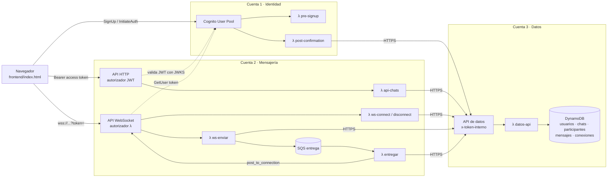

# Plataforma de mensajería en 3 cuentas de AWS Academy (Terraform)

Chat en tiempo real (1 a 1 y grupos) repartido en **tres cuentas de AWS Academy Learner Lab**,
desplegado con **Terraform**, con **autenticación en Amazon Cognito** y toda la información guardada en
**DynamoDB en una cuenta dedicada a datos**.

| Cuenta | Rol | Servicios |
|---|---|---|
| **1. Identidad** | Registro e inicio de sesión | Cognito User Pool + App Client, Lambdas *Pre Sign-up* y *Post Confirmation* |
| **2. Mensajería** | Lógica de la plataforma | API Gateway HTTP (REST), API Gateway WebSocket, 6 Lambdas, SQS (+ DLQ), S3 (frontend privado) |
| **3. Datos** | Persistencia | 5 tablas DynamoDB, Lambda + API HTTP interna de datos |

---

## 1. Arquitectura



### Cómo se conectan las cuentas (y por qué así)

En Learner Lab **no se pueden crear roles IAM** (solo existe `LabRole`) y **no hay assume-role entre
cuentas**, así que la conexión entre cuentas es por **HTTPS**, no por IAM:

1. **Cuenta 2 → Cuenta 1 (autenticación).** Cognito firma los tokens JWT con llaves públicas (JWKS).
   - La **API HTTP** usa un *autorizador JWT* nativo con el `issuer` del User Pool de la cuenta 1 y el
     `client_id` como audiencia. API Gateway descarga las llaves públicas y valida la firma sin permisos.
   - La **API WebSocket** recibe el token en `?token=` (el navegador no puede mandar headers al abrir
     un WebSocket). Un autorizador Lambda revisa `iss`, `client_id`, `token_use` y `exp`, y luego llama
     a `cognito-idp:GetUser`, que se autentica solo con el token, por lo que funciona desde otra cuenta.
2. **Cuentas 1 y 2 → Cuenta 3 (datos).** La cuenta 3 es la única que toca DynamoDB. Expone una
   *API de datos* interna; las otras cuentas la llaman con el header `x-token-interno`, un secreto
   de 48 caracteres que Terraform genera (`random_password`) y pasa como variable de entorno a las Lambdas.

> En una cuenta AWS normal lo ideal sería reemplazar el token interno por un rol IAM cross-account
> (`sts:AssumeRole`) o por una política de recurso en DynamoDB, y firmar las llamadas con SigV4.
> Vale la pena mencionarlo en la presentación como "mejora fuera del laboratorio".

### Flujo: enviar un mensaje

1. Alice inicia sesión en Cognito (cuenta 1) y recibe un **access token**.
2. Abre el WebSocket de la cuenta 2 con `?token=...`. El autorizador valida el token y `ws-connect`
   guarda la conexión en la tabla `conexiones` (cuenta 3).
3. Alice manda `{"action":"enviarMensaje","chatId":"...","texto":"Hola"}`.
4. `ws-enviar` verifica que Alice está en el chat, **guarda el mensaje** en `mensajes` (cuenta 3) y lo
   encola en **SQS**.
5. `entregar` lee la cola, busca los participantes y sus conexiones abiertas, y les empuja el mensaje
   con `post_to_connection`. Si una conexión murió (`GoneException`) la borra.
6. Si Bob estaba offline, verá el mensaje al abrir el chat (`GET /chats/{chatId}/mensajes`).

SQS desacopla "guardar" de "repartir": si la entrega falla se reintenta hasta 3 veces y luego va a la DLQ,
pero el mensaje ya quedó guardado.

### Modelo de datos (cuenta 3)

| Tabla | Clave | Índice | Para qué |
|---|---|---|---|
| `usuarios` | `userId` (= `sub` de Cognito) | `por_email` | Perfil; buscar a quién agregar a un chat |
| `chats` | `chatId` | | Nombre y creador del chat |
| `participantes` | `chatId` + `userId` | `por_usuario` (`userId`, `chatId`) | Miembros de un chat / chats de un usuario |
| `mensajes` | `chatId` + `sk` (`timestamp#messageId`) | | Historial ordenado por tiempo |
| `conexiones` | `connectionId` | `por_usuario` | WebSockets abiertos, con TTL de 24 h |

### APIs

**API HTTP (cuenta 2)**, header `Authorization: <access token>`:

| Método | Ruta | Descripción |
|---|---|---|
| GET | `/yo` | Mi perfil |
| PUT | `/yo` | Crea/actualiza mi perfil (respaldo del trigger) |
| GET | `/chats` | Mis chats |
| POST | `/chats` | `{"nombre":"Grupo","emails":["bob@x.com"]}` |
| GET | `/chats/{chatId}/mensajes` | Últimos 50 mensajes (solo participantes) |

**API WebSocket (cuenta 2)**: `wss://.../prod?token=<access token>`

- Cliente → servidor: `{"action":"enviarMensaje","chatId":"...","texto":"..."}`
- Servidor → cliente: `{"tipo":"nuevoMensaje","mensaje":{...}}` o `{"tipo":"error","error":"..."}`

---

## 2. Estructura del proyecto

```
mensajeria-aws/
├── terraform/
│   ├── versions.tf          # Terraform >= 1.5, providers aws/archive/random
│   ├── providers.tf         # 3 providers con alias: identidad, mensajeria, datos
│   ├── variables.tf
│   ├── main.tf              # token interno + los 3 módulos
│   ├── outputs.tf
│   ├── terraform.tfvars.example
│   └── modules/
│       ├── identidad/       # Cuenta 1: Cognito + triggers
│       ├── mensajeria/      # Cuenta 2: APIs, Lambdas, SQS
│       └── datos/           # Cuenta 3: DynamoDB + API de datos
├── lambdas/                 # Python 3.12, solo boto3 (sin dependencias extra)
│   ├── identidad/           # pre_signup, post_confirmation
│   ├── mensajeria/          # ws_authorizer, ws_connect, ws_disconnect, ws_enviar, entregar, api_chats
│   └── datos/               # datos_api
├── frontend/index.html      # Cliente web mínimo para probar
└── scripts/
    ├── configurar_perfiles.sh
    └── generar_config.sh
```

Todas las Lambdas usan el rol existente **`LabRole`** (`data "aws_iam_role"`); Terraform no crea
ningún rol ni política IAM.

---

## 3. Despliegue paso a paso

### Requisitos
- Terraform >= 1.5 y AWS CLI v2.
- Tres cuentas de AWS Academy Learner Lab con el lab **iniciado** (círculo verde).

### Paso 1. Iniciar los tres labs
En cada curso de Learner Lab: **Start Lab** → espera el círculo verde → **AWS Details** → **AWS CLI: Show**.

### Paso 2. Crear un perfil por cuenta
Las credenciales de Learner Lab son temporales (traen `aws_session_token` y caducan a las ~4 horas),
así que este paso se repite cada vez que reinicias el lab.

```bash
./scripts/configurar_perfiles.sh cuenta-identidad    # pega el bloque de la cuenta 1
./scripts/configurar_perfiles.sh cuenta-mensajeria   # pega el bloque de la cuenta 2
./scripts/configurar_perfiles.sh cuenta-datos        # pega el bloque de la cuenta 3
```

O a mano en `~/.aws/credentials`:

```ini
[cuenta-identidad]
aws_access_key_id=ASIA...
aws_secret_access_key=...
aws_session_token=...

[cuenta-mensajeria]
...

[cuenta-datos]
...
```

Comprueba que son 3 cuentas distintas:

```bash
for p in cuenta-identidad cuenta-mensajeria cuenta-datos; do aws sts get-caller-identity --profile $p --query Account --output text; done
```

### Paso 3. Desplegar

```bash
cd terraform
cp terraform.tfvars.example terraform.tfvars   # opcional, los valores por defecto ya sirven
terraform init
terraform plan
terraform apply
```

Un solo `apply` despliega las tres cuentas. Terraform resuelve el orden solo: primero la cuenta 3
(datos), luego la 1 (Cognito necesita la URL de datos) y luego la 2 (necesita Cognito y datos).
Si los perfiles apuntan a la misma cuenta, el bloque `check` avisa.

### Paso 4. Probar con el cliente web (URL pre-firmada de S3)

`terraform apply` sube `frontend/index.html` a un **bucket S3 privado de la cuenta 2**, con la
configuración (Cognito y URLs de las APIs) ya incrustada. El bucket no es público; se abre con una
**URL pre-firmada**:

```bash
./scripts/generar_url.sh          # 1 hora por defecto; ./scripts/generar_url.sh 7200 para 2 h
```

> Con credenciales de Learner Lab la URL deja de servir cuando caduca la sesión del lab (~4 h),
> aunque se pida más tiempo. Si deja de abrir, renueva el perfil y vuelve a generarla.

Abre la URL en **dos navegadores** (o uno normal y uno en incógnito):

1. Registra a `alice@test.com` y a `bob@test.com` (contraseña de 8+ caracteres con minúscula y número).
2. Inicia sesión con cada uno.
3. Alice crea un chat con `bob@test.com`.
4. Bob recarga sus chats, abre el chat y ambos se escriben en tiempo real.

Para desarrollo local sigue funcionando `./scripts/generar_config.sh` + `python3 -m http.server`.

### Paso 5 (opcional). Probar con la terminal

```bash
cd terraform
CLIENT=$(terraform output -raw cognito_client_id)
API=$(terraform output -raw api_http_url)
WS=$(terraform output -raw api_websocket_url)

aws cognito-idp sign-up --client-id $CLIENT --username alice@test.com --password 'clave1234' \
  --user-attributes Name=email,Value=alice@test.com --profile cuenta-identidad
TOKEN=$(aws cognito-idp initiate-auth --client-id $CLIENT --auth-flow USER_PASSWORD_AUTH \
  --auth-parameters USERNAME=alice@test.com,PASSWORD='clave1234' \
  --query AuthenticationResult.AccessToken --output text --profile cuenta-identidad)

curl -H "Authorization: $TOKEN" $API/yo
npx wscat -c "$WS?token=$TOKEN"
> {"action":"enviarMensaje","chatId":"<id>","texto":"hola"}
```

### Evidencias para la entrega
- `terraform output cuentas` muestra los 3 IDs de cuenta.
- Consola de la cuenta 1: Cognito → User pools → usuarios registrados.
- Consola de la cuenta 3: DynamoDB → `mensajeria-mensajes` → *Explore items*.
- CloudWatch Logs de cada cuenta (`/aws/lambda/mensajeria-*`).

### Paso 6. Destruir

```bash
cd terraform && terraform destroy
```

Hazlo antes de que caduquen las credenciales; si caducan, repite el paso 2 y vuelve a ejecutar.

---

## 4. Consideraciones de Learner Lab

- **Región:** solo `us-east-1` o `us-west-2` (la variable `region` lo valida).
- **IAM:** se usa `LabRole` en las 3 cuentas; no se crean roles.
- **Emails de Cognito:** el envío es limitado, por eso el trigger *Pre Sign-up* confirma usuarios
  automáticamente (`auto_confirmar_usuarios = true`). Con `false` se usa el código por email.
- **Credenciales temporales:** si `terraform` responde `ExpiredToken`, repite el paso 2.
- **Estado de Terraform:** queda local en `terraform/terraform.tfstate`. Contiene el token interno,
  así que no lo subas a un repositorio público.
- **Costos:** todo es serverless y pago por uso (DynamoDB on-demand); con pruebas pequeñas el gasto es
  de centavos del crédito del lab.

## 5. Posibles mejoras (para la sección de trabajo futuro)
- Estados de mensaje (enviado ✓ / entregado ✓✓ / leído) con una tabla `estados`.
- Media con S3 y URLs prefirmadas.
- Cifrado de extremo a extremo (como en el diseño de WhatsApp).
- Paginación del historial con `LastEvaluatedKey`.
- Fuera de Learner Lab: roles IAM cross-account en vez del token interno, y CloudFront con OAC delante del bucket del frontend.
